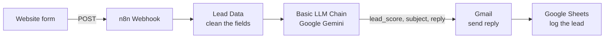
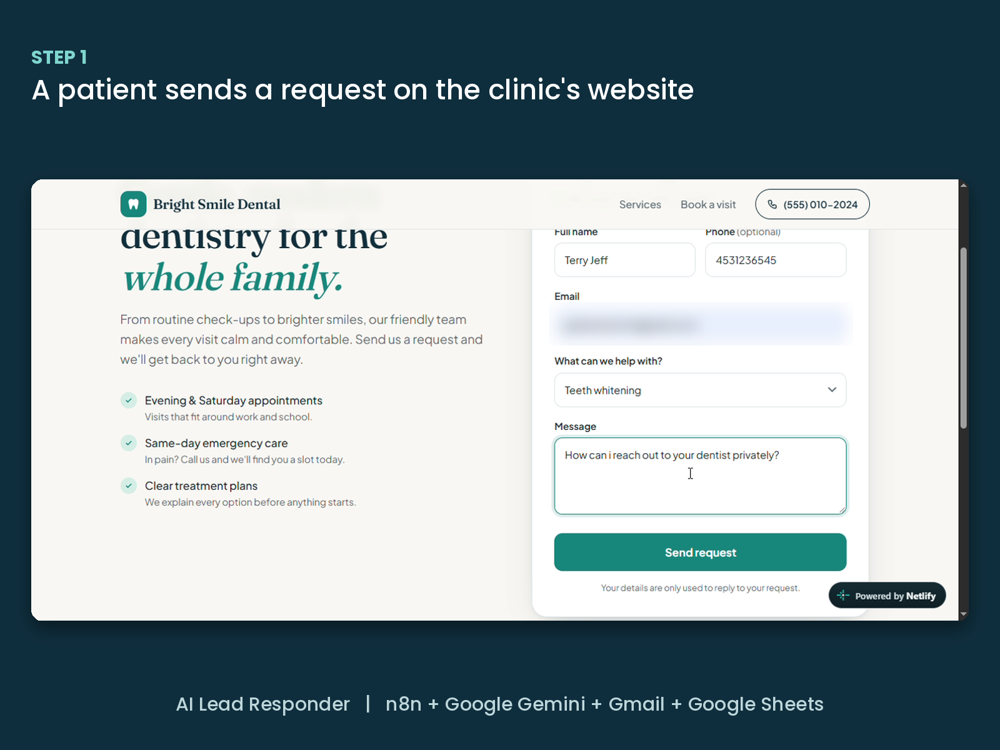
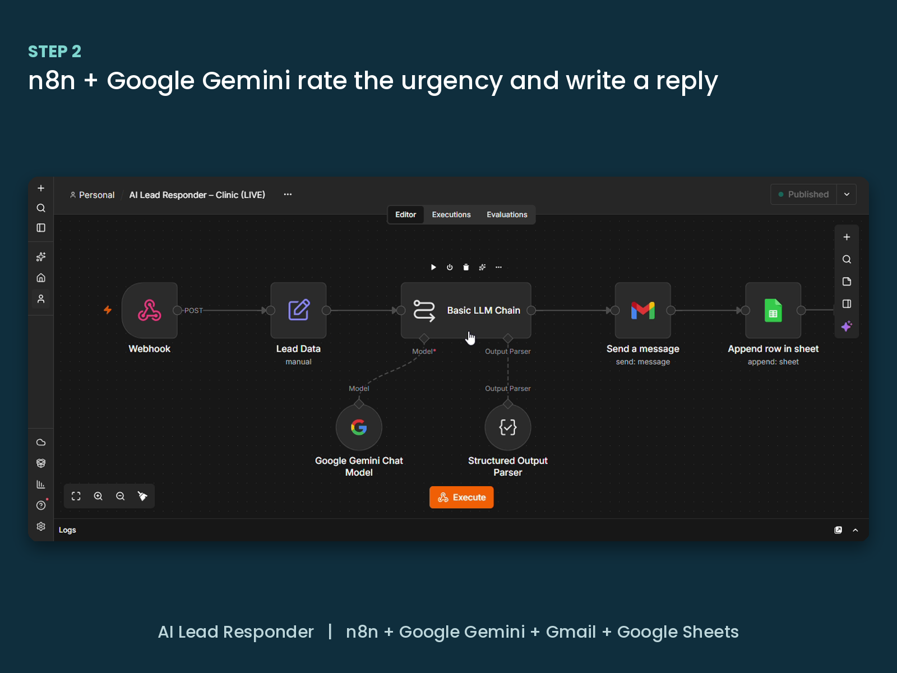
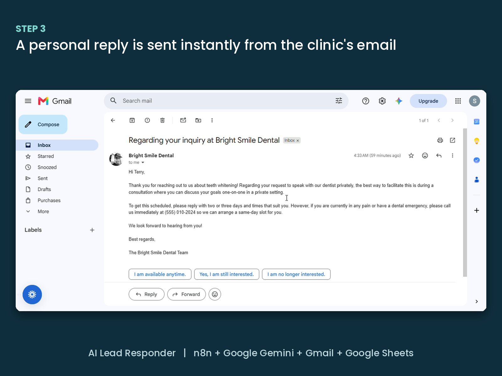
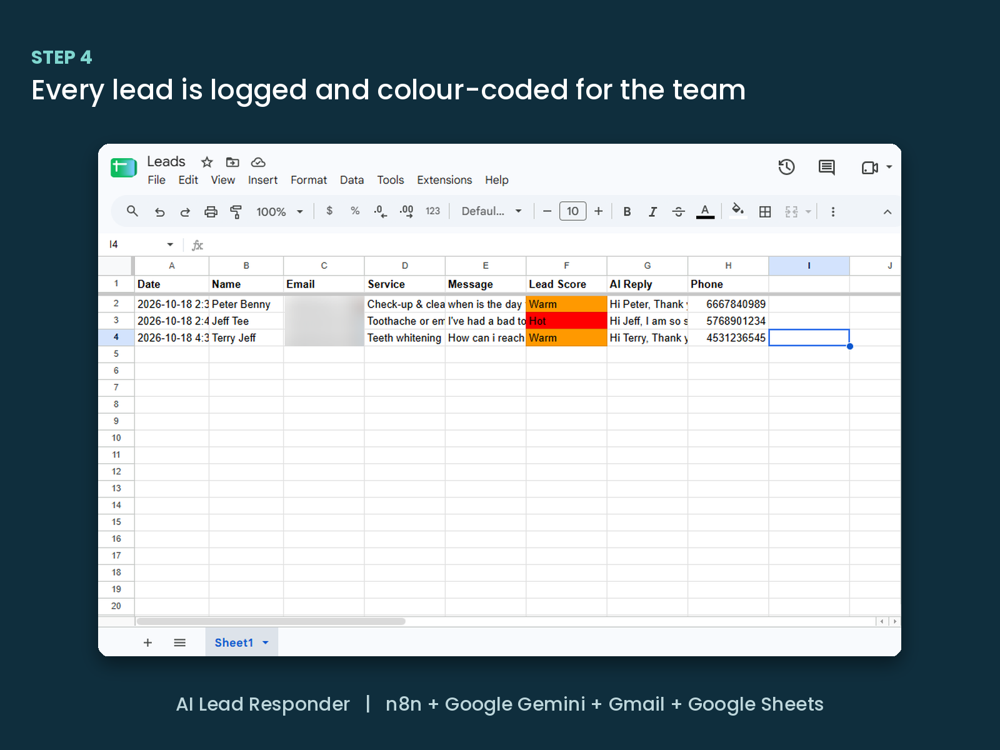

# AI Lead Responder (n8n + Google Gemini)

An AI system that replies to every website enquiry within seconds, rates how urgent it is, and logs it for the team — 24/7, with no staff involved.

Built with **n8n**, **Google Gemini**, **Gmail** and **Google Sheets**. Demonstrated here for a fictional dental clinic, *Bright Smile Dental*.

▶️ **Demo video:** [Watch on YouTube](YOUR_YOUTUBE_LINK)

---

## The problem

Small businesses lose customers when enquiries sent after hours sit unanswered until the next day. By then, many people have already contacted a competitor.

## What it does

1. A customer fills in a branded form on the business website.
2. The form sends the enquiry to an **n8n webhook**.
3. **Google Gemini** reads the message, rates the lead **Hot / Warm / Cold**, and writes a short, personal reply.
4. **Gmail** sends the reply instantly from the business's own address.
5. **Google Sheets** logs every enquiry, with urgent leads highlighted for the team.

Total time from form to reply: about 15 seconds.



## Screenshots

| Website form | n8n workflow |
|---|---|
|  |  |

| AI email reply | Lead tracker |
|---|---|
|  |  |

## Safety rules

The AI is instructed to:

- never give medical advice or diagnoses
- never quote prices
- never confirm a specific appointment time
- never make up facts about the business
- ask patients in pain or with an emergency to call the clinic directly

The model's answer is forced into a fixed structure (`lead_score`, `email_subject`, `email_reply`) with a **Structured Output Parser**, so every later step receives exactly the data it expects.

The workflow was tested with Hot, Warm and Cold enquiries before going live.

## Project structure

```
website/index.html     Branded enquiry page (HTML, CSS, JavaScript)
workflow/              n8n workflow export (import into n8n)
docs/images/           Screenshots
```

## How to set it up

1. **Import the workflow** into n8n: *Workflows → Import from file* and choose the file in `workflow/`.
2. **Add credentials** in n8n: Google Gemini (API key from Google AI Studio), Gmail and Google Sheets.
3. **Create a Google Sheet** with these headings in row 1:
   `Date | Name | Email | Service | Message | Lead Score | AI Reply | Phone`
   Then select it in the *Append row in sheet* node.
4. **Publish** the workflow and copy the Webhook node's **Production URL**.
5. In `website/index.html`, replace `PASTE_YOUR_N8N_WEBHOOK_URL_HERE` with that URL.
6. **Deploy the website** to any static host, such as Netlify or GitHub Pages.

## Tech stack

n8n · Google Gemini · Gmail · Google Sheets · Webhooks · HTML · CSS · JavaScript · Netlify

## About

Built by **Mubarak Alimi**, AI automation specialist. I build n8n and AI workflows that help small businesses respond faster and stop losing leads.

*Bright Smile Dental is a fictional business created for this demo.*
